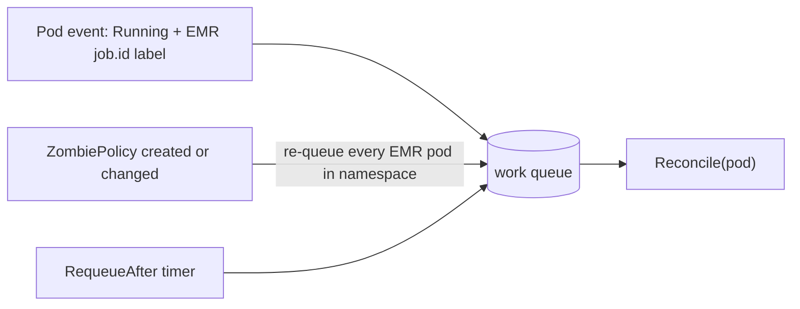
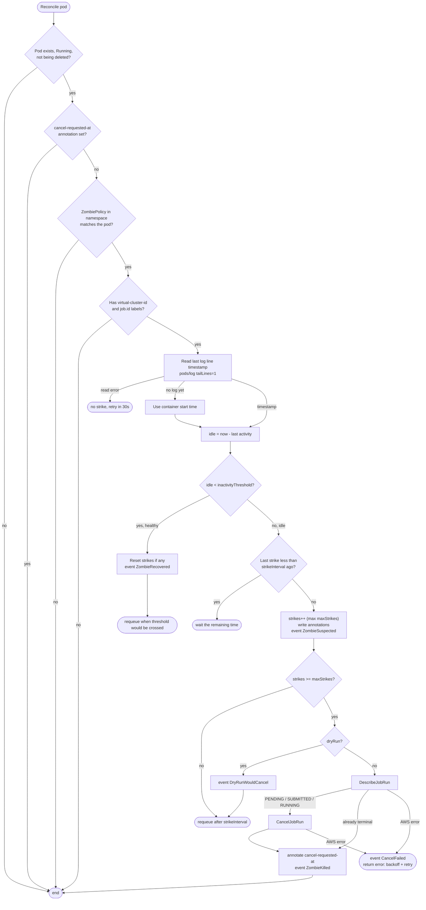

# emr-zombie-killer-k8s

A Kubernetes **watchdog** that runs inside EKS and cancels EMR on EKS job runs whose
Spark driver has stopped logging. It replaces the Lambda that polled S3
last-modified dates.

> **What this is (and isn't).** It is a controller built on controller-runtime, but not a
> declarative operator: nothing describes a desired state that it converges to. Each pass is
> a time-based health check (time since the last log line) that counts strikes and, at the
> limit, fires a one-shot `CancelJobRun`. The `Reconcile` method is only controller-runtime's
> entry point; controller-runtime provides event watching, caching, leader election and
> requeue/backoff. The `ZombiePolicy` CRD holds configuration only.

## How it works

```
Spark driver pod (Running, labelled by EMR)
        │  every strikeInterval
        ▼
 last log line timestamp  ──(GET pods/log?timestamps=true&tailLines=1)
        │
   idle ≥ inactivityThreshold (20m)?
     no  → reset strikes
     yes → strike N/3  (stored as pod annotations, survives restarts)
        │  3rd strike
        ▼
 emr-containers DescribeJobRun → still RUNNING? → CancelJobRun
        │
 Job run → CANCELLED → your orchestrator (Airflow / Step Functions) retries
```

- **Signal**: the kubelet timestamp of the newest log line of the driver container
  (`spark-kubernetes-driver`). If a pod never logged, the container start time is used.
- **Strikes**: at most one per `strikeInterval`, however many pod events fire.
  A log line appearing again resets the counter. Failing to read logs is never a strike.
- **Time to kill** ≈ `inactivityThreshold + (maxStrikes-1) × strikeInterval` = 30 min by default.
- **Retry**: the watchdog only cancels. The job run ends as `CANCELLED`; make sure your
  orchestrator treats that as retryable.
- Because the check depends on the clock, strikes are rate-limited by `strikeInterval`
  (pod events can fire `Reconcile` many times). State lives in pod annotations
  `zombie.lucabem.io/{strikes,last-strike-time,cancel-requested-at}`, so it survives restarts.
- Observability: Kubernetes events on the pod (`ZombieSuspected`, `ZombieKilled`, `ZombieRecovered`,
  `CancelFailed`, `DryRunWouldCancel`) and Prometheus metrics `zombie_killer_{strikes,cancels,cancel_errors}_total`.

## Detailed flow

### What triggers a check



### One check (`Reconcile`)



### Example timeline (defaults: 20m / 5m / 3 strikes)

| time since last log | what happens |
|---|---|
| 0 – 20 min | healthy; re-checked every ≤ 5 min, no annotations |
| ~20 min | no logs → **strike 1/3** (`ZombieSuspected`) |
| ~25 min | still silent → **strike 2/3** |
| ~30 min | still silent → **strike 3/3** → `DescribeJobRun` → `CancelJobRun` → `ZombieKilled` |
| after | EMR marks the run `CANCELLED`, the pod terminates, your orchestrator retries |

If the pod logs again at any point before the cancel, the next check resets the counter to 0
(`ZombieRecovered`) and the clock starts over. With `dryRun: true` the last step only emits
`DryRunWouldCancel`.

## Configure — `ZombiePolicy` (namespaced, configuration only)

See `config/samples/zombiepolicy.yaml`. Pods are only watched in namespaces that have a policy.

| field | default | meaning |
|---|---|---|
| `inactivityThreshold` | `20m` | silence that counts as suspicious |
| `strikeInterval` | `5m` | min time between strikes / re-check period |
| `maxStrikes` | `3` | strikes before cancelling |
| `dryRun` | `false` | only emit events/metrics |
| `container` | `spark-kubernetes-driver` | container whose logs are read |
| `selector` | driver pods with an EMR `job.id` label | which pods to watch |

## Deploy

1. IAM role for the service account (IRSA or Pod Identity) with `config/iam/policy.json`.
2. Edit the role ARN in `config/rbac/rbac.yaml`, and image/region in `config/manager/deployment.yaml`.
3. ```sh
   make docker-build IMG=<ECR_REPO>/emr-zombie-killer:v0.1.0 && docker push <ECR_REPO>/emr-zombie-killer:v0.1.0
   make deploy
   kubectl apply -f config/samples/zombiepolicy.yaml   # starts in dryRun
   ```
4. Watch `kubectl get events -n <ns> --field-selector reason=ZombieSuspected`, then set `dryRun: false`.

## Develop

```sh
make test      # unit tests (fake clock, fake log probe, fake EMR)
make generate  # after editing api/ (needs controller-gen)
```

## Code map

| path | role |
|---|---|
| `cmd/manager/main.go` | wiring only: manager, leader election, clients |
| `internal/controller/pod_watchdog.go` | `PodWatchdog`: `SetupWithManager` (what triggers a check) and `Reconcile` (one check) |
| `internal/probe/logs.go` | last log timestamp via the Kubernetes API |
| `internal/emr/client.go` | `DescribeJobRun` + `CancelJobRun` |
| `api/v1alpha1/` | `ZombiePolicy` CRD types |

## Known limits

- Only the **driver** is watched by default. A job where the driver keeps logging but an
  executor hangs is not detected.
- A driver that is legitimately silent for longer than the threshold (e.g. one long
  `collect()` with logging off) will be killed. Tune `inactivityThreshold` per namespace.
- Not a declarative operator (see top). A more idiomatic design would be one `ZombieCheck` CR
  per job run with `spec`/`status`; deliberately not done to keep this simple.
- Relies on the `emr-containers.amazonaws.com/{virtual-cluster-id,job.id}` pod labels
  that EMR on EKS sets; verify with `kubectl get pod <driver> --show-labels`.
